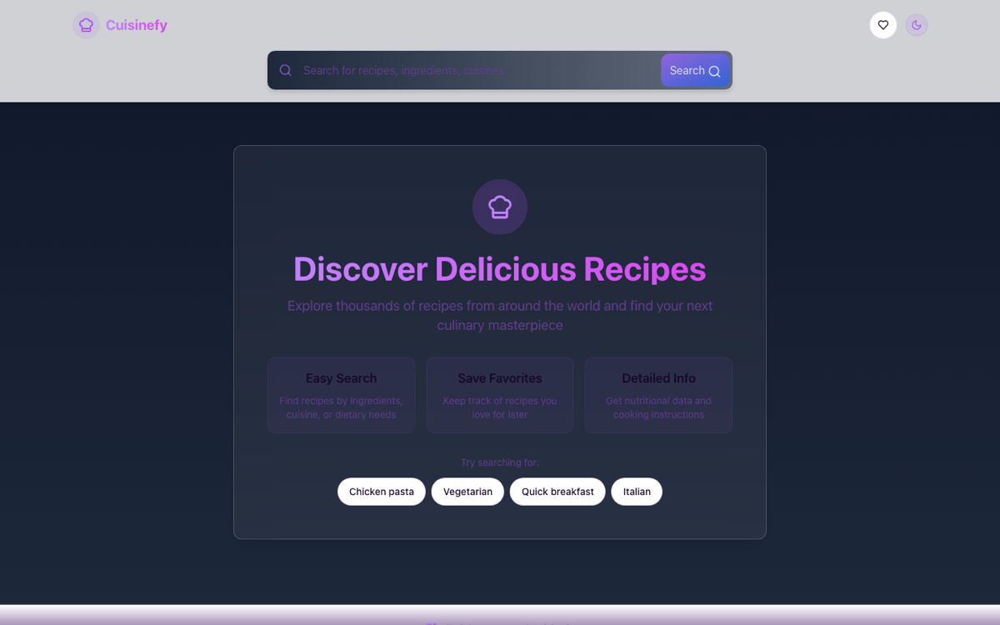

# Cuisinefy

A recipe finder built with React, TypeScript and Tailwind CSS. Search by ingredient, cuisine or dietary need, filter the results, and save favourites.

**Live:** [cu1sinefy.netlify.app](https://cu1sinefy.netlify.app)



## Features

- Search recipes by ingredients, cuisine or dietary needs
- Filter by diet, health labels and cuisine type
- Detailed recipe view with nutrition information
- Save favourite recipes (stored in the browser with `localStorage`)
- Responsive layout with light and dark themes

## Stack

React · TypeScript · Vite · Tailwind CSS · shadcn/ui · [Edamam Recipe API](https://developer.edamam.com/edamam-recipe-api)

## How it works

- `src/services/recipeService.ts` builds the Edamam v2 query from the search term and filters, and maps the response into the app's own `Recipe` type.
- `FavoritesProvider` is a React context that keeps favourites in state and syncs them to `localStorage`.
- `ThemeProvider` does the same for the light/dark theme.

## Run locally

Prerequisites: Node.js 18+.

```bash
git clone https://github.com/H41s3/cuisinefyy.git
cd cuisinefyy
npm install
cp .env.example .env   # then add your Edamam credentials
npm run dev
```

Get free credentials by signing up for the [Edamam Recipe Search API](https://developer.edamam.com/edamam-recipe-api), then fill in `.env`:

```
VITE_EDAMAM_APP_ID=your_app_id
VITE_EDAMAM_APP_KEY=your_app_key
VITE_EDAMAM_USER_ID=your_user_id
```

> Note: `VITE_` variables are bundled into the browser build, so these keys are visible to anyone using the site. That's acceptable for a free-tier demo key. A production version would call Edamam through a small backend proxy so the key stays on the server.

## Deployment

Deployed on Netlify. See [DEPLOYMENT.md](DEPLOYMENT.md) for details.

## License

MIT
